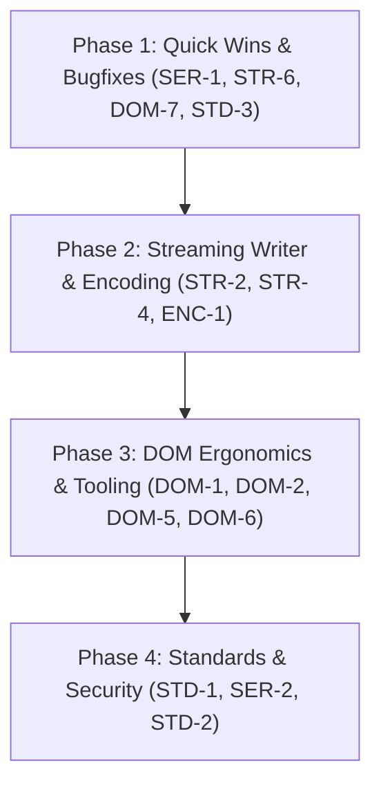

# Missing Functionality & Feature Roadmap for PetitXml (`xml` and `xml_events`)

This document provides a reviewed and pruned feature roadmap for `package:xml` (DOM tree) and `package:xml_events` (event streaming). All proposals have been audited against existing library implementations (`subtree_selector.dart`, `node_decoder.dart`, `event_decoder.dart`, `xpath`, etc.) to eliminate redundancies, low-value API churn, and out-of-scope bloat.

---

## 1. Audit Summary & Pruning Justifications

### User Review Comments & Resolutions

1. **`STR-5: Event Subtree Extraction & Skipping Helpers`**
   - *Review Comment*: *"Isn't this what @lib/src/xml_events/streams/subtree_selector.dart does?"*
   - *Codebase Audit*: **Confirmed redundant.** `lib/src/xml_events/streams/subtree_selector.dart` already provides `Stream<List<XmlEvent>>.selectSubtreeEvents(Predicate<XmlStartElementEvent> predicate)`. When combined with `.toXmlNodes()` (from `node_decoder.dart`), matching subtrees are decoded directly into `XmlNode` / `XmlElement` instances while non-matching subtrees are skipped without buffering the root document. This is documented in `README.md` and tested in `test/xml_events/stream_test.dart`.
   - *Action*: **PRUNED / REMOVED.**

2. **`STR-3: Pull-Based Reader / Cursor (XmlPullReader: Sync & Async)`**
   - *Review Comment*: *"Isn't this what @lib/src/xml_events/converters/node_decoder.dart already provides?"*
   - *Codebase Audit*: **Confirmed redundant in purpose.** Developers in other ecosystems use imperative pull cursors (Java StAX / .NET `XmlReader`) to stream large files and selectively materialize elements. In PetitXml, `toXmlEvents().selectSubtreeEvents(...).toXmlNodes()` already provides this exact capability reactively, streaming and materializing DOM elements on the fly while discarding completed subtrees. For synchronous parsing, `parseEvents(xml)` provides a lazy `Iterable<XmlEvent>`. Introducing a 20-method imperative pull cursor introduces an alien, duplicate streaming model that clashes with Dart's idiomatic reactive streams.
   - *Action*: **PRUNED / REMOVED.**

3. **`STR-1: Asynchronous Stream to DOM Parser (XmlDocument.parseStream)`**
   - *Review Comment*: *"Isn't this what @lib/src/xml_events/converters/event_decoder.dart and @lib/src/xml_events/converters/node_decoder.dart already provides?"*
   - *Codebase Audit*: **Confirmed that the streaming engine already exists.** `event_decoder.dart` provides `Stream<String>.toXmlEvents()` and `node_decoder.dart` provides `Stream<List<XmlEvent>>.toXmlNodes()`. In fact, `XmlDocument.parse(input)` is already implemented as `XmlDocument(const XmlNodeDecoder().convertIterable(parseEvents(input)))`.
   - *Action*: **DEMOTED to a minor convenience helper.** There is no missing parser engine. If added at all, `Stream<String>.toXmlDocument()` is simply a 3-line convenience extension that pipes `toXmlEvents()` through `toXmlNodes()` into `XmlDocument(nodes)`.

### Other Pruned Proposals

- **`DOM-3: Shallow Clone Support (node.copy(deep: false))`**: Pruned. Meaningless on 7 of 10 node types (attributes, text, comments, etc.). For `XmlElement`, copying name and attributes without children is a one-line constructor call (`XmlElement(el.name.copy(), el.attributes.map((a) => a.copy()))`). Pollutes the `XmlNode` interface for negligible benefit.
- **`DOM-4: CSS Selector Engine (querySelector / querySelectorAll)`**: Pruned. Redundant with `package:xml/xpath.dart`, which provides full W3C XPath 3.1. XPath is the universal query standard for XML; CSS selectors are web/HTML specific.
- **`DAT-1 & DAT-2: XML-to-Map / JSON & Object Binding`**: Pruned. W3C XDM standard JSON mapping is already implemented in `lib/src/xpath/functions/json.dart` (`fn:xml-to-json` and `fn:json-to-xml`). General XML-to-JSON is heuristic, lossy, and well-served by external packages (`xml2json`). Declarative data-class binding belongs in third-party code generators.
- **`STD-4: Safe DTD Internal Entity Expansion`**: Excluded. Expanding DTD entities is an obsolete XML feature and a major security hazard (Billion Laughs / quadratic blowup / XXE). Modern parsers deliberately ignore or reject entity expansions.
- **`STD-5 (XSD/RelaxNG) & STD-6 (XSLT)`**: Excluded by design as out of scope for a lightweight parser.

---

## 2. High-Value Task Matrix

| ID | Feature | Category | Difficulty | Frequency / Value | Status |
|---|---|---|:---:|:---:|---|
| **SER-1** | `XmlDocumentFragment` Serialization Consistency | Serialization | **Low** | **High** | Bugfix |
| **STR-6** | `XmlStartElementEvent` Attribute Accessors (`getAttribute`, `getAttributeNode`) | Streaming | **Low** | **High** | Recommended |
| **DOM-7** | Standard Namespace Resolution Helpers (`lookupPrefix` / `lookupNamespaceUri`) | DOM / Namespaces | **Low** | **Medium** | Recommended |
| **STD-3** | `xml:space` Attribute Respect in Pretty Printing | Formatting | **Low** | **Medium** | Recommended |
| **STR-2** | Streaming XML Writer (`XmlStreamWriter` / Direct Sink Output) | Streaming / Writer | **Medium** | **High** | Recommended |
| **STR-4** | Streaming Event Pretty-Printing (`XmlEventEncoder(pretty: true)`) | Streaming / Formatting | **Low** | **Medium** | Recommended |
| **ENC-1** | Encoding Detection & Byte-Stream Parsing (`Stream<List<int>>` BOM Sniffing) | I/O / Encoding | **Medium** | **High** | Recommended |
| **DOM-1** | DOM Sibling & Structural Mutations (`before`, `after`, `wrap`, `unwrap`, `prepend`) | DOM Manipulation | **Low** | **Medium** | Recommended |
| **DOM-2** | Document ID Fast Lookup (`document.getElementById`) | DOM Query | **Low** | **Medium** | Recommended |
| **DOM-5** | `XmlBuilder` Namespace Auto-Declaration & Scoping | Builder | **Low** | **Medium** | Recommended |
| **DOM-6** | Source Position Preservation on DOM Nodes (`node.start`, `node.stop`) | DOM / Diagnostics | **Medium** | **High** | Recommended |
| **STD-1** | Strict XML 1.0 Attribute Uniqueness Validation (`validateAttributes`) | Security / Compliance | **Low** | **High** | Recommended |
| **STD-2** | Canonical XML (C14N 1.0/1.1 & Exclusive C14N) | W3C Standards | **High** | **Medium** (SAML / XML-DSig) | Recommended |
| **SER-2** | Namespace Normalization / Prefix Repairing in Serialization | Serialization | **Medium** | **Medium** | Recommended |

---

## 3. Detailed Feature Specifications

### Category 1: Streaming & Asynchronous Processing

#### STR-2: Streaming XML Writer (`XmlStreamWriter` & Direct Sink Output)

- **Problem & Current Limitations**:
  `XmlWriter` only visits materialized `XmlNode` trees in memory. `XmlBuilder` accumulates all nodes in an internal `NodeDefinition` list in RAM before generating an `XmlDocument`. `XmlEventEncoder` converts `List<XmlEvent>` chunks, but requires manually constructing event objects (`XmlStartElementEvent`, `XmlEventAttribute`, `XmlEndElementEvent`). Writing gigabyte-sized XML documents (e.g. database dumps, sitemaps with 500,000 URLs) directly to an `IOSink` or `StringSink` without memory bloat is currently unsupported.
- **Proposed Dart API**:
  ```dart
  /// Forward-only streaming XML writer directly targeting a [StringSink].
  class XmlStreamWriter {
    XmlStreamWriter(
      StringSink sink, {
      XmlEntityMapping? entityMapping,
      bool pretty = false,
      String indent = '  ',
      String newLine = '\n',
    });

    void writeDeclaration({String version = '1.0', String? encoding, bool? standalone});
    void writeStartElement(String name, {String? namespaceUri});
    void writeAttribute(String name, String value, {String? namespaceUri});
    void writeText(String text);
    void writeCDATA(String cdata);
    void writeComment(String comment);
    void writeProcessingInstruction(String target, [String text]);
    void writeEndElement();
    void writeEndDocument();
    void flush();
  }
  ```
- **Implementation Strategy**:
  - Maintain an internal element tag stack (`List<String>`).
  - Defer emitting `>` on start tags until attributes are written; auto-emit `/>` if immediately followed by `writeEndElement()`.
  - Affected files: New `lib/src/xml/writer/stream_writer.dart`, exported in `lib/xml.dart`.
- **Ecosystem Precedent**: Java StAX `XMLStreamWriter`, .NET `System.Xml.XmlWriter`, Go `xml.Encoder`.

---

#### STR-4: Streaming Event Pretty-Printing (`XmlEventPrettyEncoder` / `XmlEventEncoder(pretty: true)`)

- **Problem & Current Limitations**:
  `XmlPrettyWriter` formats only in-memory `XmlNode` DOM trees. `XmlEventEncoder` outputs only compact, unindented XML. There is no way to format an XML event stream without first buffering it into full DOM nodes.
- **Proposed Dart API**:
  Add `pretty`, `indent`, and `newLine` options to `XmlEventEncoder` and `toXmlString()`:
  ```dart
  extension XmlEventEncoderExtension on Stream<List<XmlEvent>> {
    Stream<String> toXmlString({
      XmlEntityMapping? entityMapping,
      bool pretty = false,
      String indent = '  ',
      String newLine = '\n',
    });
  }
  ```
- **Implementation Strategy**:
  - In `_XmlEventEncoderSink`, maintain an integer `level` counter.
  - On `XmlStartElementEvent`, indent by `indent * level` and increment `level` (unless self-closing).
  - On `XmlEndElementEvent`, decrement `level` and indent closing tag.
  - Affected files: `lib/src/xml_events/converters/event_encoder.dart`.

---

#### STR-6: `XmlStartElementEvent` Attribute Accessors (`getAttribute`, `getAttributeNode`, `hasAttribute`)

- **Problem & Current Limitations**:
  `XmlStartElementEvent` exposes only `List<XmlEventAttribute> attributes`. When filtering event streams (e.g. inside `selectSubtreeEvents((event) => ...)`), callers must manually iterate or use `firstWhereOrNull`:
  ```dart
  stream.selectSubtreeEvents((event) =>
      event.attributes.firstWhereOrNull((a) => a.name == 'id')?.value == '123')
  ```
- **Proposed Dart API**:
  ```dart
  extension XmlStartElementEventAttributeExtension on XmlStartElementEvent {
    /// Returns the attribute value with the given [name], or `null`.
    String? getAttribute(String name, {String? namespaceUri});

    /// Returns the [XmlEventAttribute] matching [name], or `null`.
    XmlEventAttribute? getAttributeNode(String name, {String? namespaceUri});

    /// Whether an attribute with the given [name] exists.
    bool hasAttribute(String name, {String? namespaceUri});
  }
  ```
- **Implementation Strategy**:
  - Linear search over `attributes` list, matching `name` or `(localName, namespaceUri)`.
  - Affected files: `lib/src/xml_events/events/start_element.dart`.

---

### Category 2: Character Encoding & Byte Stream Handling

#### ENC-1: Encoding Detection & Byte-Stream Parsing (`Stream<List<int>>` / BOM Sniffing)

- **Problem & Current Limitations**:
  PetitXml exclusively accepts Dart UTF-16 `String`s. File and HTTP streams arrive as `Stream<List<int>>`. Standard `utf8.decode()` crashes on non-UTF-8 encodings or passes the UTF-8 BOM (`\xEF\xBB\xBF`) through as `\uFEFF`, causing parse errors or unexpected text nodes before `<?xml`.
- **Proposed Dart API**:
  ```dart
  class XmlByteStreamDecoder extends StreamTransformerBase<List<int>, String> {
    const XmlByteStreamDecoder({
      this.defaultEncoding = utf8,
      this.encodingResolver,
    });

    final Encoding defaultEncoding;
    final Encoding? Function(String name)? encodingResolver;
  }

  extension XmlByteStreamExtension on Stream<List<int>> {
    /// Decodes a byte stream to XML strings, automatically stripping BOM and resolving charset.
    Stream<String> decodeXmlStream({
      Encoding defaultEncoding = utf8,
      Encoding? Function(String name)? encodingResolver,
    });
  }
  ```
- **Implementation Strategy**:
  - Buffer leading bytes (up to 1024 bytes).
  - Detect BOM according to W3C XML 1.0 Appendix F:
    - `00 00 FE FF` -> UTF-32BE, `FF FE 00 00` -> UTF-32LE
    - `FE FF` -> UTF-16BE, `FF FE` -> UTF-16LE
    - `EF BB BF` -> UTF-8 (strip 3 bytes so `\uFEFF` does not enter the string parser)
  - If no BOM: sniff leading ASCII bytes `<?xml ... encoding="..."?>`, resolve via `Encoding.getByName(encoding)`.
  - Fall back to `defaultEncoding`.
  - Affected files: New `lib/src/xml_events/converters/byte_stream_decoder.dart`.

---

### Category 3: DOM Manipulation & Diagnostics

#### DOM-1: Standard DOM Sibling & Structural Mutations (`before`, `after`, `wrap`, `unwrap`, `prepend`)

- **Problem & Current Limitations**:
  `XmlMutatorExtension` only provides `remove()` and `replace(XmlNode other)`. Inserting a sibling before or after a node currently requires clumsy parent/child list indexing:
  ```dart
  final siblings = node.parent!.children;
  siblings.insert(siblings.indexOf(node) + 1, newNode);
  ```
  `XmlNodeList` already handles atomic moves, fragment expansion, and parent detachment.
- **Proposed Dart API**:
  ```dart
  extension XmlDomMutationExtension on XmlNode {
    /// Inserts [node] immediately before this node.
    void before(XmlNode node);

    /// Inserts [node] immediately after this node.
    void after(XmlNode node);

    /// Wraps this node with [wrapper], placing this node inside [wrapper].
    void wrap(XmlElement wrapper);

    /// Unwraps this element, replacing it with its child nodes.
    void unwrap();
  }

  extension XmlElementMutationExtension on XmlElement {
    /// Prepends [node] as the first child of this element.
    void prepend(XmlNode node);
  }
  ```
- **Implementation Strategy**:
  - Leverage `XmlNodeList` methods (`insert`, `replaceRange`, etc.) which maintain parent invariants.
  - Affected files: `lib/src/xml/extensions/mutator.dart`.

---

#### DOM-2: Document ID Fast Lookup (`document.getElementById`)

- **Problem & Current Limitations**:
  XPath 3.1 implements `fn:id` with full DTD ID and `xml:id` support (`lib/src/xpath/functions/node.dart`), but core `package:xml` has no direct `getElementById(String id)` method on `XmlDocument`. Callers without XPath must write linear descendant searches.
- **Proposed Dart API**:
  ```dart
  extension XmlDocumentIdExtension on XmlDocument {
    /// Returns the [XmlElement] matching the given [id], or `null`.
    XmlElement? getElementById(String id);
  }
  ```
- **Implementation Strategy**:
  - Fast search through `descendantElements` checking `xml:id` and `id` attributes.
  - Affected files: `lib/src/xml/nodes/document.dart`.

---

#### DOM-5: `XmlBuilder` Namespace Auto-Declaration & Scoping

- **Problem & Current Limitations**:
  Using an undeclared namespace URI in `XmlBuilder` throws `ArgumentError('Undefined namespace URI: $uri')`.
- **Proposed Improvement**:
  Automatically register an `xmlns="..."` or prefix declaration on the current element if an undeclared namespace URI is passed to `builder.element('name', namespace: uri)`.
- **Affected files**: `lib/src/xml/builder/builder.dart`.

---

#### DOM-6: Source Position Preservation on DOM Nodes (`node.start`, `node.stop`)

- **Problem & Current Limitations**:
  `XmlAnnotator` computes start and stop character offsets during parsing, and `XmlEvent` preserves them via `XmlHasLocation`. However, `XmlNodeDecoder` discards these offsets when constructing `XmlNode`s. DOM nodes cannot report which source line and column they originated from.
- **Proposed Dart API**:
  ```dart
  abstract class XmlNode extends Object with ... {
    /// Start character offset in source buffer, or `null`.
    int? get start => null;

    /// Stop character offset in source buffer, or `null`.
    int? get stop => null;
  }

  extension XmlNodeSourceLocationExtension on XmlNode {
    /// Returns 1-based (line, column) for this node using petitparser's Token utility.
    (int line, int column)? lineAndColumn(String source) {
      final position = start;
      if (position == null) return null;
      return Token.lineAndColumnOf(source, position);
    }
  }
  ```
- **Implementation Strategy**:
  - Pass start/stop offsets from `XmlAnnotator` through `XmlNodeDecoder.commit`.
  - Zero external dependencies: use `Token.lineAndColumnOf` from `package:petitparser`.
  - Affected files: `lib/src/xml/nodes/node.dart`, `lib/src/xml_events/converters/node_decoder.dart`.

---

#### DOM-7: Standard Namespace Resolution Helpers (`lookupPrefix` / `lookupNamespaceUri`)

- **Problem & Current Limitations**:
  `XmlHasNamespaces` only provides `Iterable<XmlNamespace> get namespaces sync*`. Callers (and internal XPath functions) must repeatedly write `.where((ns) => ns.prefix == p).firstOrNull?.uri`.
- **Proposed Dart API**:
  ```dart
  extension XmlNamespaceLookupExtension on XmlHasNamespaces {
    /// Returns the prefix associated with [namespaceUri], or `null`.
    String? lookupPrefix(String namespaceUri);

    /// Returns the namespace URI associated with [prefix], or `null`.
    String? lookupNamespaceUri(String? prefix);
  }
  ```
- **Implementation Strategy**:
  - Linear scan of `namespaces` iterable returning on first match.
  - Affected files: `lib/src/xml/mixins/has_namespaces.dart`.

---

### Category 4: Serialization & Normalization

#### SER-1: `XmlDocumentFragment` Serialization Consistency

- **Problem & Current Limitations**:
  `visitDocumentFragment` in `XmlWriter` outputs literal `'#document-fragment'`. Calling `fragment.toXmlString()` emits invalid markup instead of serializing the fragment's child nodes.
- **Proposed Solution**:
  ```dart
  // In XmlWriter:
  @override
  void visitDocumentFragment(XmlDocumentFragment node) {
    writeIterable(node.children);
  }
  ```
- **Affected files**: `lib/src/xml/visitors/writer.dart`.

---

#### SER-2: Namespace Normalization / Prefix Repairing in Serialization

- **Problem & Current Limitations**:
  Serializing programmatically created elements with prefixes (e.g. `<soap:Envelope>`) without explicit `xmlns:soap="..."` attributes outputs malformed XML.
- **Proposed Dart API**:
  ```dart
  String toXmlString({
    bool pretty = false,
    bool repairNamespaces = false,
    ...
  });
  ```
- **Implementation Strategy**:
  - When `repairNamespaces: true`, `XmlWriter` tracks active namespace scopes and synthesizes missing `xmlns:prefix="uri"` attributes on elements.
  - Affected files: `lib/src/xml/visitors/writer.dart`.

---

### Category 5: Standards Compliance & Security

#### STD-1: Strict XML 1.0 Well-Formedness & Attribute Uniqueness Validation (`validateAttributes`)

- **Problem & Current Limitations**:
  PetitXml allows duplicate attributes on elements (e.g. `<user role="guest" role="admin">`). Backends resolving the last occurrence while PetitXml resolves the first creates **XML Attribute Smuggling / Injection vulnerabilities (CWE-20 / CWE-287)** in authentication systems.
- **Proposed Dart API**:
  Add `validateAttributes: bool` to `XmlEventDecoder`, `XmlAnnotator`, and `XmlDocument.parse`:
  ```dart
  XmlDocument.parse(
    input, {
    bool validateAttributes = false, // When true: rejects duplicate attribute names
    XmlEntityMapping? entityMapping,
  });
  ```
- **Implementation Strategy**:
  - In `XmlAnnotator`, verify attribute names in `XmlStartElementEvent` are unique using a `Set<String>`.
  - Affected files: `lib/src/xml_events/annotations/annotator.dart`, `lib/src/xml/nodes/document.dart`.

---

#### STD-2: Canonical XML (C14N 1.0/1.1 & Exclusive C14N)

- **Problem & Current Limitations**:
  Completely missing in the Dart ecosystem. SAML 2.0, XML Digital Signatures (XML-DSig / RFC 3275), and WS-Security signatures cannot be verified or generated.
- **Proposed Dart API**:
  ```dart
  enum XmlCanonicalizationMode {
    c14n10,
    c14n10WithComments,
    c14n11,
    exclusiveC14n,
    exclusiveC14nWithComments,
  }

  extension XmlCanonicalizationExtension on XmlNode {
    /// Generates canonical XML bytes according to W3C C14N specifications.
    List<int> toCanonicalXmlBytes({
      XmlCanonicalizationMode mode = XmlCanonicalizationMode.exclusiveC14n,
      List<String>? inclusiveNamespacesPrefixList,
    });
  }
  ```
- **Technical Nuances**:
  - Attributes and namespaces must be sorted lexicographically by **Unicode code point (UCS-4 / UTF-8 byte order)** rather than UTF-16 code units.
  - Empty elements must be written as `<tag></tag>`, never `<tag/>`.
  - Line breaks normalized to `\n` (`#xA`).
  - Affected files: New visitor `lib/src/xml/visitors/canonical_writer.dart`.

---

#### STD-3: `xml:space` Attribute Respect in Pretty Printing

- **Problem & Current Limitations**:
  `XmlPrettyWriter` does not check for standard `xml:space="preserve"`, destroying whitespace inside elements like `<pre xml:space="preserve">`.
- **Proposed Solution**:
  In `XmlPrettyWriter`, check if the current element or any ancestor has `xml:space="preserve"`. If so, automatically preserve whitespace without requiring manual `preserveWhitespace` predicates.
- **Affected files**: `lib/src/xml/visitors/pretty_writer.dart`.

---

## 4. Prioritized Implementation Roadmap



| Phase | Target Features | Deliverables & Impact |
|---|---|---|
| **Phase 1: Quick Wins & Bugfixes** | **SER-1** (Fragment serialization fix)<br>**STR-6** (`XmlStartElementEvent` attribute accessors)<br>**DOM-7** (Namespace lookup helpers)<br>**STD-3** (`xml:space` auto-detection) | Resolves bug in fragment serialization and fixes daily papercuts with zero architectural risk. |
| **Phase 2: Streaming Writer & Encoding** | **STR-2** (`XmlStreamWriter` direct sink output)<br>**STR-4** (Streaming pretty encoder)<br>**ENC-1** (Byte stream decoding & BOM sniffing) | Solves high-memory exhaustion on large file generation and handles raw byte streams with BOMs. |
| **Phase 3: DOM Ergonomics & Tooling** | **DOM-1** (DOM mutations: `before`, `after`, `wrap`, `unwrap`, `prepend`)<br>**DOM-2** (`getElementById` lookup)<br>**DOM-5** (`XmlBuilder` namespace auto-declaration)<br>**DOM-6** (Source line & column offset preservation) | Dramatically improves DOM manipulation ergonomics, AST tooling, and diagnostic reporting. |
| **Phase 4: Standards & Security** | **STD-1** (Strict attribute uniqueness validation against smuggling)<br>**SER-2** (Namespace prefix repairing)<br>**STD-2** (Canonical XML C14N 1.0/1.1/Exclusive) | Enterprise crypto compliance (SAML/XML-DSig) and parser security hardening. |
